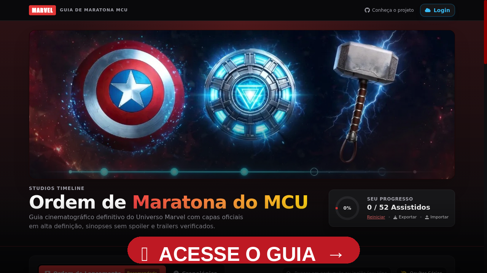

<div align="center">


<br><br>

<h1>🛡️ Guia de Maratona MCU</h1>
<p><em>O companheiro definitivo para maratonar o Universo Cinematográfico Marvel na ordem certa.</em></p>

<br>

[](https://flou-ainan.github.io/mcu-guide/)

</div>

---

## 💡 Sobre o Projeto

Tudo começou de um jeito simples: eu queria maratonar o MCU com meus amigos, mas a internet estava cheia de listas desatualizadas, spoilers escondidos mal, e nada que realmente fosse **prático de usar no sofá**, no celular, enquanto a gente decidia o que assistir a seguir.

Então eu construí.

O **Guia de Maratona MCU** nasceu como um projeto pessoal — uma lista simples — e virou uma aplicação completa, com sincronização em nuvem, comentários da comunidade, cenas pós-créditos catalogadas, trailers integrados e muito mais. Hoje é a ferramenta que eu gostaria de ter encontrado lá no começo.

> *"Parte do caminho é preservar o que você já percorreu." — Adaptado de Thanos (mas sem os crimes de guerra)*

---

## ✨ Funcionalidades

### 🗂️ Organização & Navegação

| Funcionalidade | Descrição |
|---|---|
| **Ordem de Lançamento** | Assista na sequência em que os filmes chegaram aos cinemas |
| **Ordem Cronológica** | Siga a linha do tempo interna do MCU |
| **Filtro por Fase** | Separe Fase 1, 2, 3, 4 e 5 com um clique |
| **Filtro por Status** | Veja só o que ainda falta assistir |
| **Badges de Cânone** | Identifique rapidamente o que é **Canônico MCU** ou **Ignorável** |

### 🎬 Cards Detalhados

| Funcionalidade | Descrição |
|---|---|
| **Capas Oficiais HD** | Pôsteres oficiais via IMDB com carregamento progressivo |
| **Skeleton Loading** | Animação estilo YouTube enquanto as capas carregam |
| **Sinopses sem Spoiler** | Resumos cuidadosamente escritos |
| **Trailers Integrados** | Assistir direto no guia, sem sair da página |
| **Link para o IMDB** | Acesso rápido à página oficial do filme |
| **Cenas Pós-Créditos** 🆕 | Badge com contagem + timestamps exatos de cada cena |

### 📊 Progresso Pessoal

| Funcionalidade | Descrição |
|---|---|
| **Marcar como Assistido** | Um clique — salvo localmente de imediato |
| **Barra de Progresso** | Visual global + por série (com % exibida) |
| **Exportar / Importar** | Faça backup do seu progresso em JSON |
| **Offline First** | Funciona sem login, sem internet |

### ☁️ Sincronização na Nuvem

| Funcionalidade | Descrição |
|---|---|
| **Login com GitHub** | Autenticação segura via Supabase Auth |
| **Sync Automático** | Progresso salvo na nuvem, acessível em qualquer dispositivo |
| **Perfil Personalizado** | Avatar e nome via conta GitHub |

### 💬 Comunidade & Comentários

| Funcionalidade | Descrição |
|---|---|
| **Comentários por Título** | Discussão pública por filme e série |
| **Markdown Suportado** | Negrito, itálico, listas, citações, código e imagens |
| **Preview em Tempo Real** | Alterne entre `✏️ Escrever` e `👁 Preview` |
| **Modal de Imagem** | Insira imagens com descrição e preview antes de publicar |
| **Respostas Encadeadas** | Responda diretamente a um comentário |
| **Reações com Emoji** | 👍 ❤️ 😂 😮 😢 😡 |
| **Histórico de Edições** | Veja todas as versões anteriores de um comentário |
| **Data e Hora** | Timestamp preciso em cada mensagem |

---

## 🎬 O que tem dentro

```
📦 52 títulos do MCU
 ├── 🎥 37 Filmes  (Fase 1 → Fase 5)
 └── 📺 15 Séries  (Disney+ e +)

🕐 Cenas Pós-Créditos catalogadas em todos os filmes
   └── timestamps exatos para você não perder nada

🌐 Dois modos de ordem
   ├── Lançamento (como o mundo viu)
   └── Cronológica (como os personagens viveram)
```

---

## 🚀 Como rodar localmente

```bash
# Clone o repositório
git clone https://github.com/flou-ainan/mcu-guide.git
cd mcu-guide

# Inicie um servidor local (qualquer um funciona)
python3 -m http.server 8080
# ou: npx serve .
# ou: npx live-server

# Abra no navegador
open http://localhost:8080
```

> **Nota:** O projeto é um SPA puro — zero dependências de build. Basta um servidor HTTP estático.

---

## 🔒 Privacidade & Segurança

- **Sem tracking.** Não usamos Google Analytics nem cookies de terceiros.
- **Dados locais são seus.** O progresso fica no `localStorage` do seu browser.
- **Supabase Auth** é usado exclusivamente para autenticação e sync opcional.
- **Comentários são públicos.** Pense bem antes de publicar informações pessoais.
- **Imagens externas** são exibidas diretamente da URL fornecida — não hospedamos imagens. Recomendamos o [ImgBB](https://imgbb.com) para hospedar.

---

## 🛠️ Stack Tecnológico

```
Frontend: HTML5 · CSS3 · Vanilla JS (ES2022+)
Estilo:   Tailwind CSS (CDN) · Custom Properties
Auth:     Supabase Auth (GitHub OAuth)
Database: Supabase (PostgreSQL)
Deploy:   GitHub Pages (CD automático via push)
Dados:    mcu_data.json (curado manualmente) + data.js (fallback)
```

---

## 👨‍💻 Autor

Feito com ❤️ e muito café por **[flou-ainan](https://github.com/flou-ainan)**.

Se você curtiu o projeto, deixa uma ⭐ — isso faz toda a diferença!

---

<div align="center">

**[🌐 Acessar o Guia](https://flou-ainan.github.io/mcu-guide/)** · **[🐛 Reportar Bug](https://github.com/flou-ainan/mcu-guide/issues)** · **[💡 Sugerir Feature](https://github.com/flou-ainan/mcu-guide/issues)**

<sub>MCU Guide não tem afiliação com a Marvel Studios ou Disney. Feito por fãs, para fãs.</sub>

</div>
